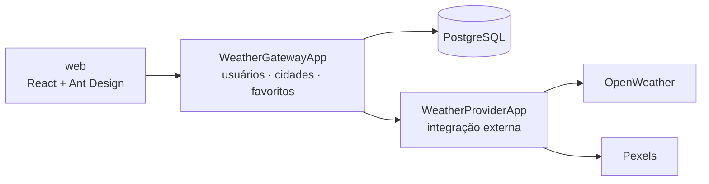

# Climato

App de clima em **microsserviços** com .NET e React: pesquise uma cidade, veja o clima atual com uma foto dela ao fundo e guarde suas favoritas.

> 🚧 **Em evolução.** Criado na faculdade para praticar microsserviços, o projeto está sendo evoluído como portfólio de backend .NET — segurança, resiliência, cache, testes, containers e deploy. O roteiro e as decisões estão em [`docs/project-overview.md`](docs/project-overview.md).

## Arquitetura

Detalhes em [`docs/architecture/system-design.md`](docs/architecture/system-design.md).

## Stack

.NET · ASP.NET Core · EF Core · PostgreSQL · React · Vite · Ant Design

## Como rodar

Veja [`docs/runbook.md`](docs/runbook.md).

## Documentação

[`docs/README.md`](docs/README.md) — arquitetura, decisões (ADRs), roteiro e fases.
