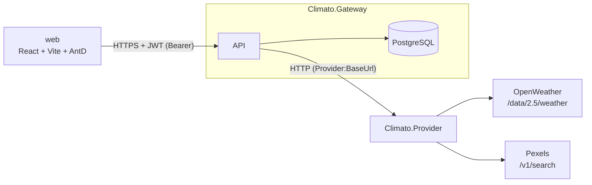
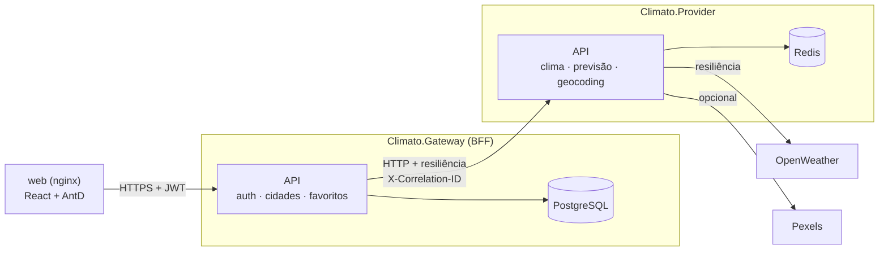

# Climato — System Design

## Visão Geral

Dois serviços .NET e um SPA React. O frontend fala **só** com o Gateway; o Gateway é o único que conhece o Provider; o Provider é o único que conhece as APIs externas.

### Estado atual

### Arquitetura-alvo (fim da Fase 08)

## Responsabilidades

| Serviço | Responsável por | Não faz |
|---|---|---|
| **Climato.Gateway** | Usuários e autenticação (JWT), histórico de cidades e favoritos por usuário, composição das respostas para o front | Chamar APIs externas diretamente |
| **Climato.Provider** | Traduzir OpenWeather/Pexels para um contrato próprio (camada anticorrupção), cache, resiliência contra as APIs externas | Persistir dados de usuário; conhecer usuários |
| **web** | Interface; guarda o token e chama o Gateway | Regra de negócio (ex.: "não excluir favorita" fica no backend) |

**Por que dois serviços:** o Provider isola a dependência externa (troca de provedor de clima, cotas, cache) e escala de forma independente; o Gateway concentra estado e identidade. Ver [ADR 0001](decisions/0001-evolucao-incremental-dois-servicos.md).

## Fluxos

### Autenticação

1. `POST /auth/register` ou `POST /auth/login` → Gateway valida (FluentValidation), confere o hash e devolve `{ token, expiresAt, user }`.
2. O web guarda token e expiração (`services/session.js`) e envia `Authorization: Bearer` em toda chamada.
3. O Gateway valida assinatura, emissor, audiência e validade; o usuário vem da claim `sub`.
4. Token ausente ou expirado → 401 → o web limpa a sessão e volta para `/signin`.

### Consulta de clima

1. `GET /weathers/{cidade}` no Gateway com `Authorization: Bearer`.
2. Gateway chama `GET /weathers?cityName=` no Provider (retry/timeout/circuit breaker).
3. Provider consulta o cache (`clima:{cidade-normalizada}`, TTL 10 min; Redis ou memória); em miss, chama OpenWeather e, de forma opcional, Pexels; grava no cache.
4. Gateway registra a cidade no histórico do usuário (se ainda não existir) e devolve o clima.

### Previsão de 5 dias

1. `GET /forecasts/{cidade}` no Gateway com `Authorization: Bearer`.
2. Gateway chama `GET /forecasts?cityName=` no Provider.
3. Provider consulta o cache (`previsao:{cidade-normalizada}`, TTL 30 min); em miss, chama OpenWeather `data/2.5/forecast` e agrega os pontos de 3 h por dia no fuso da cidade (até 5 dias).
4. Gateway devolve a previsão **sem** registrar a cidade no histórico.

### Busca de cidades

1. `GET /locations?query=` no Gateway (2 a 100 caracteres; senão 400).
2. Gateway chama `GET /locations?query=` no Provider.
3. Provider consulta o cache (`locais:{texto-normalizado}`, TTL 24 h); em miss, chama OpenWeather `geo/1.0/direct` (`limit=5`) e devolve `{ name, state, country }`, com o nome em português quando houver.

### Mapeamento de erros

| Situação | Provider responde | Gateway responde |
|---|---|---|
| Cidade não existe na OpenWeather (clima ou previsão) | 404 | 404 (não entra no histórico) |
| OpenWeather fora / timeout / circuito aberto / 401 de chave / 429 | 503 | 503 |
| Pexels falha | 200 sem `imageUrl` | 200 |
| Provider fora ou circuito aberto | — | 503 |
| Cliente abortou a requisição | 499 | 499 |
| Busca com `query` < 2 ou > 100 caracteres | 400 | 400 |
| Busca sem resultado | 200 `[]` | 200 `[]` |

Todas as respostas de erro em `application/problem+json`.

### Health checks

| Serviço | `/health/live` | `/health/ready` |
|---|---|---|
| Provider | processo vivo | Redis (se configurado; falha = `Degraded`, 200) |
| Gateway | processo vivo | Postgres + `/health/ready` do Provider |

## Dados

PostgreSQL, propriedade exclusiva do Gateway.

| Tabela | Colunas | Observações |
|---|---|---|
| `user` | id, email (único, minúsculo), name, passwordhash (PBKDF2), createdat | Nome reservado no Postgres — sempre entre aspas no SQL |
| `city` | id, userid → user (cascade), name, country, isfavorite, createdat | Uma linha por cidade **por usuário** |

Schema versionado por EF Core Migrations (`Gateway.Infrastructure/Data/Migrations/`).

## Integrações externas

| API | Uso | Plano / limite | Configuração |
|---|---|---|---|
| OpenWeather Current Weather `2.5/weather` | Clima atual | Free: 60 req/min, 1M/mês | `OpenWeather:ApiKey` |
| OpenWeather 5 day / 3 hour `2.5/forecast` | Previsão | Free | idem |
| OpenWeather Geocoding `geo/1.0/direct` | Autocomplete | Free | idem |
| Pexels `v1/search` | Foto da cidade | 200 req/h | `Pexels:ApiKey` |

Os limites gratuitos são o motivo do cache no Provider e do usuário de demonstração na Fase 08.
