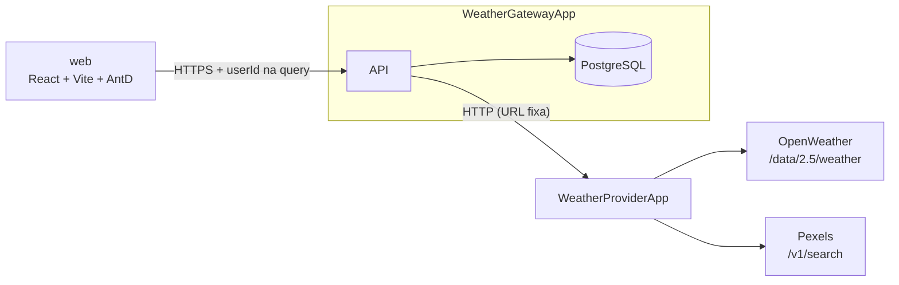

# Climato — System Design

## Visão Geral

Dois serviços .NET e um SPA React. O frontend fala **só** com o Gateway; o Gateway é o único que conhece o Provider; o Provider é o único que conhece as APIs externas.

### Estado atual

### Arquitetura-alvo (fim da Fase 08)

## Responsabilidades

| Serviço | Responsável por | Não faz |
|---|---|---|
| **WeatherGatewayApp** | Usuários e autenticação (JWT), histórico de cidades e favoritos por usuário, composição das respostas para o front | Chamar APIs externas diretamente |
| **WeatherProviderApp** | Traduzir OpenWeather/Pexels para um contrato próprio (camada anticorrupção), cache, resiliência contra as APIs externas | Persistir dados de usuário; conhecer usuários |
| **web** | Interface; guarda o token e chama o Gateway | Regra de negócio (ex.: "não excluir favorita" fica no backend) |

**Por que dois serviços:** o Provider isola a dependência externa (troca de provedor de clima, cotas, cache) e escala de forma independente; o Gateway concentra estado e identidade. Ver [ADR 0001](decisions/0001-evolucao-incremental-dois-servicos.md).

## Fluxos

### Consulta de clima (alvo)

1. `GET /weathers/{cidade}` no Gateway com `Authorization: Bearer`.
2. Gateway chama `GET /weathers?cityName=` no Provider (retry/timeout/circuit breaker).
3. Provider consulta o cache (`clima:{cidade-normalizada}`); em miss, chama OpenWeather e, de forma opcional, Pexels; grava no cache.
4. Gateway registra a cidade no histórico do usuário (se ainda não existir) e devolve o clima.

### Mapeamento de erros (alvo, Fase 03)

| Situação | Provider responde | Gateway responde |
|---|---|---|
| Cidade não existe na OpenWeather | 404 | 404 |
| OpenWeather fora / timeout / 401 de chave | 502 / 503 | 503 |
| Pexels falha | 200 sem `imageUrl` | 200 |
| Provider fora ou circuito aberto | — | 503 |

Todas as respostas de erro em `application/problem+json`.

## Dados

PostgreSQL, propriedade exclusiva do Gateway.

| Tabela | Colunas | Observações |
|---|---|---|
| `user` | id, email (único), name, password (hash a partir da Fase 02), createdat | Nome reservado no Postgres — sempre entre aspas no SQL |
| `city` | id, userid → user (cascade), name, country, isfavorite, createdat | Uma linha por cidade **por usuário** |

Schema versionado por EF Core Migrations a partir da Fase 01.

## Integrações externas

| API | Uso | Plano / limite | Configuração |
|---|---|---|---|
| OpenWeather Current Weather `2.5/weather` | Clima atual | Free: 60 req/min, 1M/mês | `OpenWeather:ApiKey` |
| OpenWeather 5 day / 3 hour `2.5/forecast` | Previsão (Fase 03) | Free | idem |
| OpenWeather Geocoding `geo/1.0/direct` | Autocomplete (Fase 03) | Free | idem |
| Pexels `v1/search` | Foto da cidade | 200 req/h | `Pexels:ApiKey` |

Os limites gratuitos são o motivo do cache no Provider e do usuário de demonstração na Fase 08.
