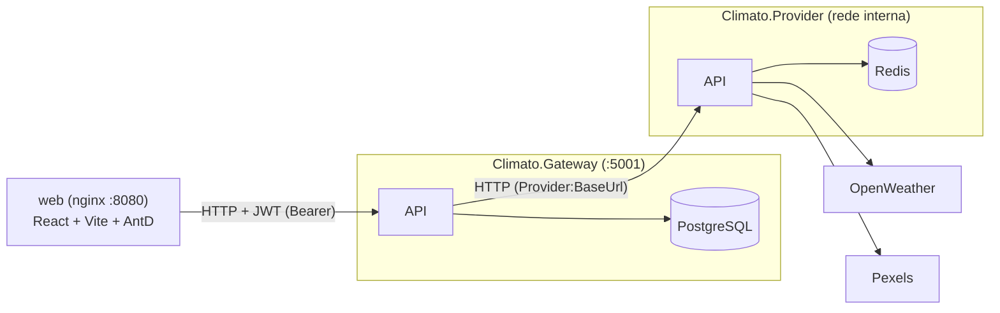

# Fase 05 — Containers e CI: Plano de Implementação

> **Para agentes:** usar `superpowers:executing-plans` (ou `superpowers:subagent-driven-development`) tarefa a tarefa. Passos com checkbox (`- [ ]`) — marcar ao concluir (regra GE-05).

**Objetivo:** `docker compose up` sobe gateway, provider, postgres, redis e web num clone limpo, e todo PR passa por CI (build e testes .NET, lint e build do web, build das imagens), conforme o [design aprovado](design.md).

**Arquitetura:** primeiro as duas mudanças de código (flag de migration e timeout dos health checks), depois as imagens .NET, a imagem do web (com lockfile npm), o compose, o workflow de CI e por fim a documentação. Cada tarefa termina verificada e vira um commit.

**Stack:** Docker (multi-stage) · Docker Compose · nginx · GitHub Actions · .NET 10 · Node 24.

## Restrições globais

- Ler [`backend.md`](../../architecture/backend.md) e [`frontend.md`](../../architecture/frontend.md) antes de editar. O design vale mais que este plano em caso de conflito.
- Mudanças em `src/` **só** as da Tarefa 1 (flag `Database:MigrateOnStartup` e timeout de 3 s nos health checks).
- **Nenhum segredo versionado** (BE-01): chaves só no `.env` local (ignorado por `**/.env`); o repositório tem só `.env.example` com valores vazios. Nos testes manuais, usar chaves fictícias (`chave-ficticia`) — nunca ler user-secrets nem `appsettings.Development.json` do usuário.
- Portas: Gateway `5001:8080`, web `8080:80`; Provider, Postgres e Redis sem porta no host.
- Imagens base: `mcr.microsoft.com/dotnet/sdk:10.0`, `mcr.microsoft.com/dotnet/aspnet:10.0`, `node:24-alpine`, `nginx:alpine`, `postgres:17-alpine`, `redis:7-alpine`.
- **Commits:** um por tarefa (0–6), com as mensagens indicadas. A aprovação deste plano é a autorização explícita para esses commits (mesma exceção das Fases 01–04). Antes de cada commit, `/revisar-padrao`; com 🔴, parar.
- Mensagens de commit em português, imperativo, terminando com `Co-Authored-By: Claude Opus 5.5 <noreply@anthropic.com>`.
- Branch: `dev/containers-ci`, a partir do `origin/master` **com o PR #12 (Fase 04) mergeado**.
- Fora do escopo: publicar imagens, deploy (08), testes de integração (backlog), logs (06), healthcheck de container nas APIs.

## Mapa de arquivos

| Arquivo | Ação | Tarefa |
|---|---|---|
| `docs/features/05-containers-ci/{design,plan}.md` | Criar (já escritos) | 0 |
| `src/Gateway/Climato.Gateway.Api/Program.cs` | Modificar | 1 |
| `src/Gateway/Climato.Gateway.Infrastructure/DependencyInjection.cs` | Modificar | 1 |
| `src/Provider/Climato.Provider.Api/DependencyInjection.cs` | Modificar | 1 |
| `.dockerignore` | Criar | 2 |
| `src/Gateway/Climato.Gateway.Api/Dockerfile`, `src/Provider/Climato.Provider.Api/Dockerfile` | Criar | 2 |
| `web/package-lock.json` | Criar (gerado) | 3 |
| `web/Dockerfile`, `web/nginx.conf`, `web/.dockerignore` | Criar | 3 |
| `docker-compose.yml`, `.env.example` | Criar | 4 |
| `.github/workflows/ci.yml` | Criar | 5 |
| `docs/runbook.md`, `CLAUDE.md`, `docs/architecture/{backend,frontend,system-design}.md` | Modificar | 6 |
| `docs/project-overview.md`, `docs/features/00-roteiro-portfolio/auditoria-inicial.md` | Modificar | 6 |

---

### Tarefa 0: Preparar a branch e versionar o design

- [ ] **Passo 1:** com o PR #12 mergeado: `git fetch`, `git switch -c dev/containers-ci origin/master`, `git branch --unset-upstream`. `git log --oneline -1` mostra o merge do PR #12. Os arquivos não rastreados de `docs/features/05-containers-ci/` acompanham a troca de branch.
- [ ] **Passo 2:** commit dos documentos:

```bash
git add docs/features/05-containers-ci/
git commit -m "Adiciona design e plano da Fase 05 (containers e CI)" -m "Co-Authored-By: Claude Opus 5.5 <noreply@anthropic.com>"
```

---

### Tarefa 1: Flag de migration e timeout dos health checks

**Files:**
- Modify: `src/Gateway/Climato.Gateway.Api/Program.cs`, `src/Gateway/Climato.Gateway.Infrastructure/DependencyInjection.cs`, `src/Provider/Climato.Provider.Api/DependencyInjection.cs`

**Interfaces:**
- Produces: chave de configuração `Database:MigrateOnStartup` (bool; padrão `true` só em `Development`), usada pelo compose (Tarefa 4) como `Database__MigrateOnStartup`.

- [x] **Passo 1: `Program.cs` do Gateway** — trocar

```csharp
if (!app.Environment.IsProduction())
{
```

por

```csharp
if (app.Configuration.GetValue("Database:MigrateOnStartup", app.Environment.IsDevelopment()))
{
```

(o corpo do `if` não muda).

- [x] **Passo 2: timeout no Gateway** — em `Climato.Gateway.Infrastructure/DependencyInjection.cs`, acrescentar `using Microsoft.Extensions.Diagnostics.HealthChecks;`, a constante na classe

```csharp
    private static readonly TimeSpan healthCheckTimeout = TimeSpan.FromSeconds(3);
```

e, logo depois do `services.AddHealthChecks()...;` existente:

```csharp
        services.PostConfigure<HealthCheckServiceOptions>(options =>
        {
            foreach (var registration in options.Registrations)
            {
                registration.Timeout = healthCheckTimeout;
            }
        });
```

- [x] **Passo 3: timeout no Provider** — em `Climato.Provider.Api/DependencyInjection.cs` (já tem `using Microsoft.Extensions.Diagnostics.HealthChecks;`), mesma constante na classe e o mesmo bloco `services.PostConfigure<HealthCheckServiceOptions>(...)` logo antes do `return services;`.

- [x] **Passo 4: verificar**

Run: `dotnet build Climato.slnx` → 0 erros, 0 avisos. `dotnet test --solution Climato.slnx` → 73/73.
Run: `dotnet run --project src/Gateway/Climato.Gateway.Api --launch-profile https` com o Postgres local do runbook → sobe e migra como antes (ambiente `Development`, flag ausente). Parar com Ctrl+C. (Se não houver Postgres local, esta checagem fica para o `docker compose up` da Tarefa 4.)

- [x] **Passo 5: `/revisar-padrao` e commit**

```bash
git add src/
git commit -m "Adiciona flag de migration no startup e timeout nos health checks" -m "Co-Authored-By: Claude Opus 5.5 <noreply@anthropic.com>"
```

---

### Tarefa 2: Imagens do Gateway e do Provider

**Files:**
- Create: `.dockerignore`, `src/Gateway/Climato.Gateway.Api/Dockerfile`, `src/Provider/Climato.Provider.Api/Dockerfile`

**Interfaces:**
- Produces: imagens construídas com **contexto na raiz do repositório** (`docker build -f <Dockerfile> .`), escutando HTTP na porta 8080; DLLs de entrada `Climato.Gateway.Api.dll` e `Climato.Provider.Api.dll`.

- [x] **Passo 1: `.dockerignore`** (raiz)

```
**/bin/
**/obj/
**/node_modules/
**/dist/
**/.vs/
**/.idea/
**/.vscode/
**/*.user
**/appsettings.Development.json
**/appsettings.Local.json
**/secrets.json
**/.env
.git/
.github/
.superpowers/
.claude/
docs/
tests/
web/
```

- [x] **Passo 2: `src/Gateway/Climato.Gateway.Api/Dockerfile`**

```dockerfile
FROM mcr.microsoft.com/dotnet/sdk:10.0 AS build
WORKDIR /src

COPY global.json Directory.Build.props Directory.Packages.props ./
COPY src/Gateway/Climato.Gateway.Api/Climato.Gateway.Api.csproj src/Gateway/Climato.Gateway.Api/
COPY src/Gateway/Climato.Gateway.Application/Climato.Gateway.Application.csproj src/Gateway/Climato.Gateway.Application/
COPY src/Gateway/Climato.Gateway.Domain/Climato.Gateway.Domain.csproj src/Gateway/Climato.Gateway.Domain/
COPY src/Gateway/Climato.Gateway.Infrastructure/Climato.Gateway.Infrastructure.csproj src/Gateway/Climato.Gateway.Infrastructure/
RUN dotnet restore src/Gateway/Climato.Gateway.Api/Climato.Gateway.Api.csproj

COPY src/Gateway/ src/Gateway/
RUN dotnet publish src/Gateway/Climato.Gateway.Api/Climato.Gateway.Api.csproj -c Release -o /app/publish --no-restore

FROM mcr.microsoft.com/dotnet/aspnet:10.0
WORKDIR /app
COPY --from=build /app/publish .
USER $APP_UID
EXPOSE 8080
ENTRYPOINT ["dotnet", "Climato.Gateway.Api.dll"]
```

- [x] **Passo 3: `src/Provider/Climato.Provider.Api/Dockerfile`**

```dockerfile
FROM mcr.microsoft.com/dotnet/sdk:10.0 AS build
WORKDIR /src

COPY global.json Directory.Build.props Directory.Packages.props ./
COPY src/Provider/Climato.Provider.Api/Climato.Provider.Api.csproj src/Provider/Climato.Provider.Api/
COPY src/Provider/Climato.Provider.Application/Climato.Provider.Application.csproj src/Provider/Climato.Provider.Application/
COPY src/Provider/Climato.Provider.Domain/Climato.Provider.Domain.csproj src/Provider/Climato.Provider.Domain/
RUN dotnet restore src/Provider/Climato.Provider.Api/Climato.Provider.Api.csproj

COPY src/Provider/ src/Provider/
RUN dotnet publish src/Provider/Climato.Provider.Api/Climato.Provider.Api.csproj -c Release -o /app/publish --no-restore

FROM mcr.microsoft.com/dotnet/aspnet:10.0
WORKDIR /app
COPY --from=build /app/publish .
USER $APP_UID
EXPOSE 8080
ENTRYPOINT ["dotnet", "Climato.Provider.Api.dll"]
```

- [x] **Passo 4: verificar**

Run (raiz):
- `docker build -f src/Gateway/Climato.Gateway.Api/Dockerfile -t climato-gateway .` → sucesso
- `docker build -f src/Provider/Climato.Provider.Api/Dockerfile -t climato-provider .` → sucesso
- `docker run --rm -e ASPNETCORE_ENVIRONMENT=Production -e OpenWeather__ApiKey=chave-ficticia -e Pexels__ApiKey=chave-ficticia -p 5002:8080 climato-provider` e, em outro terminal, `curl -s http://localhost:5002/health/live` → `Healthy`. Parar o container.
- Se o `restore` falhar porque o `global.json` pede um SDK que a imagem não tem, **parar e reportar** (não alterar o `global.json` sem acordo).

- [x] **Passo 5: `/revisar-padrao` e commit**

```bash
git add .dockerignore src/Gateway/Climato.Gateway.Api/Dockerfile src/Provider/Climato.Provider.Api/Dockerfile
git commit -m "Adiciona as imagens Docker do Gateway e do Provider" -m "Co-Authored-By: Claude Opus 5.5 <noreply@anthropic.com>"
```

---

### Tarefa 3: Lockfile npm e imagem do web

**Files:**
- Create: `web/package-lock.json` (gerado), `web/Dockerfile`, `web/nginx.conf`, `web/.dockerignore`

**Interfaces:**
- Produces: imagem do web construída com **contexto `web/`** e `--build-arg VITE_API_URL=...`, servindo na porta 80.

- [x] **Passo 1: lockfile** — em `web/`: `npm install` (gera `package-lock.json` a partir do `package.json`, sem mudar o `package.json`). Conferir `git diff web/package.json` vazio. Depois `npm run lint` e `npm run build` → sem erros.

- [x] **Passo 2: `web/.dockerignore`**

```
node_modules/
dist/
.env
.env.*
```

- [x] **Passo 3: `web/nginx.conf`**

```nginx
server {
    listen 80;
    root /usr/share/nginx/html;
    index index.html;

    location / {
        try_files $uri $uri/ /index.html;
    }
}
```

- [x] **Passo 4: `web/Dockerfile`**

```dockerfile
FROM node:24-alpine AS build
WORKDIR /app

COPY package.json package-lock.json ./
RUN npm ci

COPY . .
ARG VITE_API_URL
ENV VITE_API_URL=$VITE_API_URL
RUN npm run build

FROM nginx:alpine
COPY nginx.conf /etc/nginx/conf.d/default.conf
COPY --from=build /app/dist /usr/share/nginx/html
EXPOSE 80
```

- [x] **Passo 5: verificar**

Run:
- `docker build --build-arg VITE_API_URL=http://localhost:5001 -t climato-web web` → sucesso
- `docker run --rm -p 8080:80 climato-web`; `curl -s http://localhost:8080/` e `curl -s http://localhost:8080/signin` → ambos devolvem o HTML do `index.html` (fallback de SPA). Confirmar que o bundle contém a URL: `docker run --rm climato-web sh -c "grep -l 'localhost:5001' /usr/share/nginx/html/assets/*.js"` → um arquivo. Parar o container.

- [x] **Passo 6: `/revisar-padrao` e commit**

```bash
git add web/package-lock.json web/Dockerfile web/nginx.conf web/.dockerignore
git commit -m "Versiona o lockfile npm e adiciona a imagem do web com nginx" -m "Co-Authored-By: Claude Opus 5.5 <noreply@anthropic.com>"
```

---

### Tarefa 4: `docker-compose.yml` e `.env.example`

**Files:**
- Create: `docker-compose.yml`, `.env.example`

**Interfaces:**
- Consumes: Dockerfiles das Tarefas 2–3; `Database__MigrateOnStartup` da Tarefa 1.
- Produces: variáveis `OPENWEATHER_API_KEY`, `PEXELS_API_KEY`, `JWT_SECRET_KEY`, `POSTGRES_PASSWORD` (usadas também pelo CI da Tarefa 5).

- [ ] **Passo 1: `.env.example`** (raiz)

```dotenv
# Copie para .env e preencha. O .env é ignorado pelo git.

# Chaves gratuitas: https://openweathermap.org/api e https://www.pexels.com/api/
OPENWEATHER_API_KEY=
PEXELS_API_KEY=

# Pelo menos 32 caracteres. Ex.: openssl rand -base64 48
JWT_SECRET_KEY=

# Senha do Postgres do compose (sem ";" — entra na connection string)
POSTGRES_PASSWORD=
```

- [ ] **Passo 2: `docker-compose.yml`** (raiz)

```yaml
name: climato

services:
  postgres:
    image: postgres:17-alpine
    environment:
      POSTGRES_DB: climato
      POSTGRES_USER: postgres
      POSTGRES_PASSWORD: ${POSTGRES_PASSWORD:?Defina POSTGRES_PASSWORD no .env (ver .env.example)}
    volumes:
      - climato-postgres:/var/lib/postgresql/data
    healthcheck:
      test: ["CMD-SHELL", "pg_isready -U postgres -d climato"]
      interval: 5s
      timeout: 3s
      retries: 10

  redis:
    image: redis:7-alpine
    healthcheck:
      test: ["CMD", "redis-cli", "ping"]
      interval: 5s
      timeout: 3s
      retries: 10

  provider:
    build:
      context: .
      dockerfile: src/Provider/Climato.Provider.Api/Dockerfile
    environment:
      ASPNETCORE_ENVIRONMENT: Production
      OpenWeather__ApiKey: ${OPENWEATHER_API_KEY:?Defina OPENWEATHER_API_KEY no .env (ver .env.example)}
      Pexels__ApiKey: ${PEXELS_API_KEY:?Defina PEXELS_API_KEY no .env (ver .env.example)}
      ConnectionStrings__Redis: redis:6379,abortConnect=false,connectTimeout=1000
    depends_on:
      redis:
        condition: service_healthy

  gateway:
    build:
      context: .
      dockerfile: src/Gateway/Climato.Gateway.Api/Dockerfile
    environment:
      ASPNETCORE_ENVIRONMENT: Production
      ConnectionStrings__Climato: Host=postgres;Port=5432;Database=climato;Username=postgres;Password=${POSTGRES_PASSWORD:?Defina POSTGRES_PASSWORD no .env (ver .env.example)}
      Jwt__SecretKey: ${JWT_SECRET_KEY:?Defina JWT_SECRET_KEY no .env (ver .env.example)}
      Provider__BaseUrl: http://provider:8080/
      Cors__AllowedOrigins__0: http://localhost:8080
      Database__MigrateOnStartup: "true"
    ports:
      - "5001:8080"
    depends_on:
      postgres:
        condition: service_healthy
      provider:
        condition: service_started

  web:
    build:
      context: web
      args:
        VITE_API_URL: http://localhost:5001
    ports:
      - "8080:80"
    depends_on:
      gateway:
        condition: service_started

volumes:
  climato-postgres:
```

- [ ] **Passo 3: verificar a falta de variáveis** — sem `.env`: `docker compose config` → erro citando `Defina POSTGRES_PASSWORD no .env`.

- [ ] **Passo 4: verificar a subida** — criar um `.env` **local e não versionado** com valores fictícios (`OPENWEATHER_API_KEY=chave-ficticia`, `PEXELS_API_KEY=chave-ficticia`, `JWT_SECRET_KEY=` 48 caracteres aleatórios, `POSTGRES_PASSWORD=senha-local-123`). Então:
  - `docker compose up --build -d` → os 5 serviços `running`; `docker compose ps` mostra postgres e redis `healthy`.
  - `curl -s http://localhost:5001/health/ready` → `Healthy` (Postgres + Provider).
  - `docker compose logs gateway` mostra as migrations aplicadas no banco vazio.
  - `curl -s -X POST http://localhost:5001/auth/register -H "Content-Type: application/json" -d '{"email":"compose@teste.dev","name":"Compose","password":"senha-de-teste-123"}'` → 201 com token.
  - `curl -s -o /dev/null -w "%{http_code}" -H "Origin: http://localhost:8080" -X OPTIONS http://localhost:5001/auth/login -H "Access-Control-Request-Method: POST"` → 204 (CORS liberado para o web).
  - `curl -s http://localhost:8080/` → HTML do web.
  - Busca de clima com chave fictícia: `GET /weathers/Lima` autenticado → **503** (OpenWeather recusa a chave): confirma a cadeia Gateway → Provider → OpenWeather. O teste com chaves reais é do usuário (runbook).
  - `docker compose down -v`; apagar o `.env` fictício.

- [ ] **Passo 5: `/revisar-padrao` e commit** (conferir `git status`: `.env` **não** aparece)

```bash
git add docker-compose.yml .env.example
git commit -m "Adiciona o docker-compose com gateway, provider, postgres, redis e web" -m "Co-Authored-By: Claude Opus 5.5 <noreply@anthropic.com>"
```

---

### Tarefa 5: CI no GitHub Actions

**Files:**
- Create: `.github/workflows/ci.yml`

- [ ] **Passo 1: `.github/workflows/ci.yml`**

```yaml
name: CI

on:
  pull_request:
  push:
    branches: [master]

concurrency:
  group: ci-${{ github.ref }}
  cancel-in-progress: true

permissions:
  contents: read

jobs:
  backend:
    name: Backend (.NET)
    runs-on: ubuntu-latest
    steps:
      - uses: actions/checkout@v5
      - uses: actions/setup-dotnet@v5
        with:
          dotnet-version: 10.0.x
      - run: dotnet build Climato.slnx
      - run: dotnet test --solution Climato.slnx

  web:
    name: Web
    runs-on: ubuntu-latest
    defaults:
      run:
        working-directory: web
    steps:
      - uses: actions/checkout@v5
      - uses: actions/setup-node@v5
        with:
          node-version: 24
          cache: npm
          cache-dependency-path: web/package-lock.json
      - run: npm ci
      - run: npm run lint
      - run: npm run build
        env:
          VITE_API_URL: http://localhost:5001

  docker:
    name: Imagens Docker
    runs-on: ubuntu-latest
    env:
      OPENWEATHER_API_KEY: ci
      PEXELS_API_KEY: ci
      JWT_SECRET_KEY: ci-somente-build-sem-uso-real-0123456789abcdef
      POSTGRES_PASSWORD: ci
    steps:
      - uses: actions/checkout@v5
      - run: docker compose build
```

Os valores do job `docker` só satisfazem a interpolação do compose no build; não são segredos e nenhum container sobe.

- [ ] **Passo 2: verificar localmente** — com as mesmas variáveis exportadas no shell (`OPENWEATHER_API_KEY=ci PEXELS_API_KEY=ci JWT_SECRET_KEY=... POSTGRES_PASSWORD=ci docker compose build`) → sucesso. A execução real acontece no PR (Tarefa 6): se algum job falhar no GitHub, corrigir antes do merge.

- [ ] **Passo 3: `/revisar-padrao` e commit**

```bash
git add .github/workflows/ci.yml
git commit -m "Adiciona o CI com build e testes .NET, lint e build do web e build das imagens" -m "Co-Authored-By: Claude Opus 5.5 <noreply@anthropic.com>"
```

---

### Tarefa 6: Documentação e fechamento da Fase 05

**Files:**
- Modify: `docs/runbook.md`, `CLAUDE.md`, `docs/architecture/backend.md`, `docs/architecture/frontend.md`, `docs/architecture/system-design.md`, `docs/project-overview.md`, `docs/features/00-roteiro-portfolio/auditoria-inicial.md`

- [ ] **Passo 1: `runbook.md`**
  - Trocar a linha "Alvo futuro: `docker compose up` (Fase 05). Até lá, os serviços sobem com `dotnet run`." por: "Dois jeitos de rodar: **Docker** (tudo de uma vez, recomendado para avaliar) ou **`dotnet run`** (desenvolvimento, seções 1–4)."
  - Nova seção logo depois do título, antes de **Pré-requisitos**:

````markdown
## Docker (recomendado)

Pré-requisitos: Docker com Compose v2 e as chaves gratuitas da OpenWeather e da Pexels.

```bash
cp .env.example .env
# preencher OPENWEATHER_API_KEY, PEXELS_API_KEY, JWT_SECRET_KEY (≥ 32 caracteres) e POSTGRES_PASSWORD
docker compose up --build
```

| Serviço | URL |
|---|---|
| Web | `http://localhost:8080` |
| Gateway | `http://localhost:5001` (`/health/ready`) |

Provider, Postgres e Redis ficam só na rede interna do compose. As APIs rodam em `Production` (sem Scalar); o Gateway aplica as migrations na subida (`Database__MigrateOnStartup=true`). A primeira subida baixa imagens e compila tudo (alguns minutos).

- Zerar o banco: `docker compose down -v`.
- Faltou variável no `.env`: o compose para com "Defina … no .env".
- A URL do Gateway fica fixada no build do web (`VITE_API_URL`); mudou a porta, rode `docker compose build web`.
````

  - Na seção **Pré-requisitos** (caminho `dotnet run`), trocar "Node.js LTS (≥ 20)" por "Node.js 24 LTS".
  - Nova seção no fim:

```markdown
## CI e proteção do `master`

O workflow `.github/workflows/ci.yml` roda em todo PR e push no `master`: **Backend (.NET)** (build + testes), **Web** (lint + build) e **Imagens Docker** (`docker compose build`). Para impedir merge com CI ❌ (regra do `CLAUDE.md`), o dono do repositório ativa uma vez no GitHub: *Settings → Branches → Add branch ruleset* (ou *Branch protection rule*) para `master` → *Require status checks to pass* → marcar os três jobs.
```

- [ ] **Passo 2: `CLAUDE.md` › Verificação**

```bash
dotnet build Climato.slnx
dotnet test --solution Climato.slnx
npm --prefix web run lint
npm --prefix web run build
docker compose build
```

Frase abaixo do bloco: "O CI (`.github/workflows/ci.yml`) roda os mesmos passos em todo PR; o `docker compose build` precisa de um `.env` preenchido (ver [`runbook.md`](docs/runbook.md#docker-recomendado))."

- [ ] **Passo 3: `backend.md`**
  - **Migrations:** trocar "Aplicadas automaticamente no startup fora de `Production`;" por "Aplicadas no startup quando `Database:MigrateOnStartup` é `true` (padrão: `true` só em `Development`; o compose liga explicitamente);".
  - **Health checks:** acrescentar o item "- Timeout de 3 s por check (`PostConfigure<HealthCheckServiceOptions>`), para um check travado não segurar o `/health/ready`."
  - **Configuração e segredos:** acrescentar o item "- Containers: imagens multi-stage (`sdk:10.0` → `aspnet:10.0`, usuário não-root), HTTP na porta 8080, `ASPNETCORE_ENVIRONMENT=Production`; configuração só por variáveis de ambiente (`docker-compose.yml` lê do `.env`, que não é versionado)."

- [ ] **Passo 4: `frontend.md`**
  - **Stack:** acrescentar "· npm (`package-lock.json` versionado; `npm ci` no CI e na imagem)".
  - **Chamadas à API:** depois do item da URL base, acrescentar "- Na imagem Docker o `VITE_API_URL` é fixado no build (`--build-arg`), não em runtime; o web é servido por nginx com fallback de SPA (`web/nginx.conf`)."

- [ ] **Passo 5: `system-design.md`** — trocar o título "### Estado atual" por "### Estado atual (compose)" e o diagrama por:

````markdown


`docker compose up` sobe os cinco containers; Provider, Postgres e Redis não expõem porta no host.
````

- [ ] **Passo 6: `auditoria-inicial.md`**
  - A23, Status: `✅ Fase 01 (sln, appsettings, launchSettings) · ✅ Fase 05 (Docker)`.
  - A25, Status: `🟡 CI, Docker e health checks ✅ (Fases 03 e 05) · logs estruturados na 06`.

- [ ] **Passo 7: `project-overview.md`**
  - Estado Atual: data e "(após a Fase 05)"; em **Funciona**, acrescentar "`docker compose up` com os cinco serviços e CI em todo PR"; em **Não há**, remover "Docker, CI"; na **Stack**, acrescentar `Docker · Docker Compose · nginx · GitHub Actions`.
  - Fase 05:

```markdown
#### Fase 05 — Containers e CI ✅ Concluída (AAAA-MM-DD)
Dockerfiles multi-stage (Gateway, Provider, web com nginx), `docker-compose.yml` com Postgres e Redis, `.env.example`, flag `Database:MigrateOnStartup`, timeout nos health checks e GitHub Actions (backend, web, imagens).
Design: [`design.md`](features/05-containers-ci/design.md) · Plano: [`plan.md`](features/05-containers-ci/plan.md)
Auditoria: A23 (Docker), A25 (parcial: CI).
```

  - Pendências: remover os três itens `[Fase 05]` (lockfile, estratégia de migration, timeout dos health checks). No item `[Backlog]` de testes de integração, manter a nota de incluir no CI.

- [ ] **Passo 8: verificação completa**

Run, na raiz, com um `.env` fictício local (não versionado):
- `dotnet build Climato.slnx` → 0 erros, 0 avisos
- `dotnet test --solution Climato.slnx` → 73/73
- `npm --prefix web ci`, `npm --prefix web run lint`, `npm --prefix web run build` → sem erros
- `docker compose build` → sucesso
- `git status` → nenhum `.env` nem segredo rastreado

- [ ] **Passo 9: `/revisar-padrao` e commit**

```bash
git add CLAUDE.md docs/
git commit -m "Documenta Docker e CI e fecha a Fase 05" -m "Co-Authored-By: Claude Opus 5.5 <noreply@anthropic.com>"
```

- [ ] **Passo 10: PR** — com o usuário de acordo: push e PR `dev/containers-ci` → `master` citando **A23** e **A25 (parcial)**. Os três jobs do CI precisam ficar verdes no próprio PR; com ❌, corrigir antes do merge. Lembrar o usuário de ativar a proteção do `master` (runbook).
